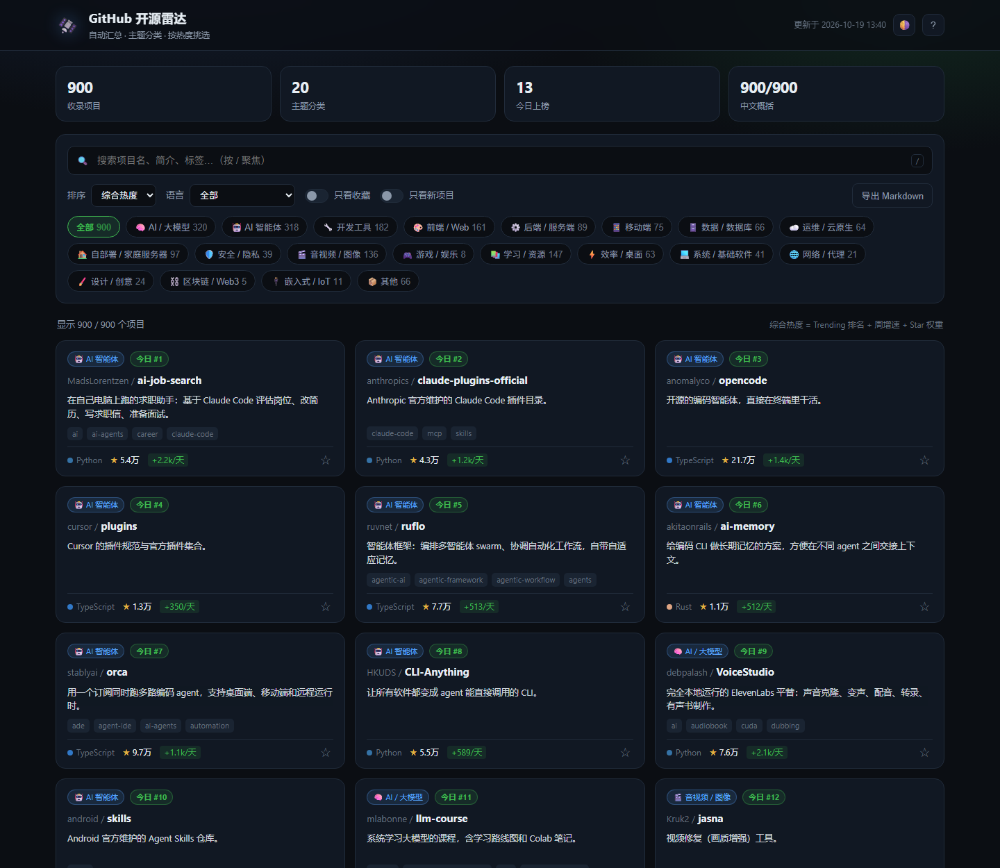

# GitHub 开源雷达

> 定期汇总 GitHub 上的热门开源项目，按主题自动分类，每个项目配一句**中文概括**，做成一个能搜索、能筛选、能收藏的静态站点。
> 自用挑项目，也可以直接挂到 GitHub Pages 当「开源技术分享」站点。



## 它做了什么

- **每天自动采集**：12 次 GitHub 搜索查询（近半年新星、45 天新星、小众宝藏、活跃巨头，以及 AI、智能体、自部署、开发工具、学习资源、音视频六类补充）+ GitHub Trending 网页。去重后约 986 条，按热度保留 **900 条**。
- **每个项目都有中文概括**：卡片正文显示「这是什么、能干什么」，鼠标悬停看仓库英文原文，详情里中英文对照。目前覆盖 **900/900**。
- **自动分类**：按仓库 topics 和简介关键词打标签，一个项目可属于多个主题（AI / 智能体 / 开发工具 / 前端 / 后端 / 移动端 / 数据 / 运维 / 自部署 / 安全 / 音视频 / 游戏 / 学习 / 效率 / 系统 / 网络 / 设计 / 区块链 / 嵌入式）。
- **热度排序**：Trending 排名 + 周 Star 增量 + 总 Star 加权，不是单纯按总星排。另可按「最新创建」找新项目。
- **新项目标记**：最近 90 天创建的仓库带橙色 `NEW`，可一键「只看新项目」，专门用来挖刚冒头的宝藏仓库。
- **历史快照**：每次采集存一份 Star 快照，从第二次运行开始就有「+X/周」的真实涨幅。
- **站点功能**：搜索、分类筛选、语言筛选、7 种排序、收藏（存本机）、详情弹窗、导出 Markdown、深浅色主题。
- **零依赖**：不需要 `npm install`，一个 Node 脚本 + 三个静态文件。

## 快速开始

```bash
# 1. 采集数据（第一次约 1.5~2 分钟，无 Token 时 GitHub 会限速）
npm run collect

# 2. 本地预览
npm run serve
# 打开 http://127.0.0.1:4321/
```

也可以不启服务器，直接双击 `index.html` —— 数据通过 `data/latest.js` 注入，`file://` 下也能看。

> **Windows 上如果报 `UNABLE_TO_VERIFY_LEAF_SIGNATURE` / 证书错误**：说明机器上装了代理或抓包工具的根证书，Node 默认不信任系统证书库。用 `npm run collect`（已带 `--use-system-ca`）即可；直接跑脚本时写 `node --use-system-ca scripts/collect.mjs`。

## 目录结构

```
.
├── index.html                      # 站点入口
├── assets/
│   ├── style.css                   # 样式（深浅色主题）
│   └── app.js                      # 前端逻辑（无框架）
├── data/
│   ├── latest.json                 # 最新一次采集结果（提交进仓库的唯一数据源）
│   ├── latest.js                   # 由 latest.json 生成（不提交，file:// 也能直接读）
│   ├── summary-zh.json             # 中文概括主文件：仓库名 → 一句话中文
│   ├── notes.json                  # 人工精修的中文简介（优先级高于 summary-zh）
│   └── history/YYYY-MM-DD.json     # 每日 Star 快照，用来算涨幅
├── scripts/
│   ├── config.mjs                  # 采集范围：查询语句、条数、限速
│   ├── classify.mjs                # 分类规则：主题 + 关键词
│   ├── trending.mjs                # 解析 GitHub Trending 网页
│   ├── collect.mjs                 # 主流程
│   ├── pending-summaries.mjs       # 列出还没中文概括的项目
│   ├── apply-summaries.mjs         # 把 `编号|中文` 批量合并进 summary-zh.json
│   ├── build.mjs                   # latest.json → latest.js
│   ├── build-site.mjs              # 生成可部署的 _site/ 目录
│   ├── serve.mjs                   # 本地预览服务器（4321 端口）
│   └── update-local.ps1            # Windows 定时任务用的包装脚本
├── netlify.toml                    # Netlify 构建配置
├── .github/workflows/update.yml    # 每天自动采集 + 部署 Pages
└── docs/screenshot.png
```

## 采集方式与数量

| 来源 | 用途 | 条数 |
| --- | --- | --- |
| `created:>=180天 stars:>=1000` | 近半年在火的新项目 | 2 页 = 200 |
| `stars:>=20000 pushed:>=45天` | 活跃的头部项目（基础盘） | 2 页 = 200 |
| `created:>=45天 stars:>=150` | 刚冒头的新星 | 1 页 = 100 |
| `created:>=150天 stars:150..3000 pushed:>=14天` | 小众但还在更新的「宝藏」 | 1 页 = 100 |
| `topic:llm` / `ai-agents` / `self-hosted` / `developer-tools` / `awesome` / `video` | 补全分类覆盖 | 6 页 ≈ 585 |
| `github.com/trending?since=daily` / `weekly` | 当日榜单与涨幅 | 网页解析 |

- 12 次查询合计约 1185 条原始结果，去重后 986 条，按热度截断保留 900 条（`config.mjs` 里的 `maxProjects`）。
- Trending 网页本身一页只有 13~25 条，所以「今日上榜」数量少是正常的，它只负责提供当日涨幅。
- 未配置 Token 时搜索接口限 **10 次/分钟**，脚本按 6.5 秒间隔自动限速，一次完整采集约 100 秒；配 `GITHUB_TOKEN` 后是 30 次/分钟，可调小 `searchDelayMs`。
- 首次运行没有历史快照，日/周涨幅为空是正常的；第二天再跑一次就有了。

## 中文概括是怎么来的

`data/summary-zh.json` 是主文件，格式是 `"owner/repo": "一句话中文"`，由人工（或 AI 批量）整理，不是逐字翻译 —— 目标是一眼知道「这是什么、能干什么」。

新项目补写的流程：

```bash
# 1. 列出还没有中文概括的项目，输出 data/_pending.txt（编号 + 仓库名 + 英文简介）
npm run summary:pending

# 2. 按编号写一批 data/_batch-*.txt，每行 `编号|中文概括`

# 3. 合并进 summary-zh.json
npm run summary:apply -- data/_batch-1.txt data/_batch-2.txt

# 4. 重新合并进站点数据
npm run collect -- --reuse
```

优先级：`notes.json`（人工精修） > `summary-zh.json`（主文件） > 仓库英文原文。没有中文时页面自动回退显示英文，不会留空。

## 想改成自己的口味

- **换采集范围**：改 `scripts/config.mjs` 的 `collections`（每条 = 一次 `GET /search/repositories` 查询）。比如只看 Rust：`q: 'language:Rust stars:>=3000 pushed:>2026-01-01'`。
- **加减分类**：改 `scripts/classify.mjs` 的 `CATEGORIES`（展示名、图标）和 `RULES`（topics / 关键词）。topic 命中记 3 分、简介关键词记 1.5 分，≥1.5 分归类，最多保留 3 个分类。
- **改完规则不想重新请求 GitHub**：`npm run collect -- --reuse`，复用 `data/latest.json` 只重算分类和中文概括，0.1 秒出结果。

## 部署到免费静态托管

站点是纯静态的，所有平台用同一套构建方式：

- **构建命令**：`node scripts/build-site.mjs`
- **发布目录**：`_site`

`netlify.toml` 里已经写好了这两项，Netlify 导入仓库后不用再改设置。

### Netlify（你打算用的这个）

1. 仓库推到 GitHub 后，Netlify 控制台 **Add new site → Import an existing project → GitHub**，选中仓库。
2. Build command / Publish directory 会自动读取 `netlify.toml`，直接 Deploy。
3. 之后每次 GitHub 上有新 commit（包括 Actions 每天提交的数据更新），Netlify 都会自动重新构建发布。
4. **绑定自己的域名**：**Domain management → Add a domain** 填域名，两种接法：
   - 把域名的 NS 改成 Netlify DNS（最省事，CDN 和证书自动配好）；
   - 或在域名服务商加一条 `CNAME` 指向 `<站点名>.netlify.app`（根域名用 `A` 记录指向 Netlify 给的负载均衡 IP）。HTTPS 证书自动签发，不用手动续。

免费额度：100GB 带宽/月、300 构建分钟/月。这个站构建一次约 1 分钟，每天一次完全够。

### Cloudflare Pages（带宽不限，可作为主站）

1. Cloudflare 控制台 **Workers & Pages → Create → Pages → Connect to Git**，选仓库。
2. Framework preset 选 `None`，Build command 填 `node scripts/build-site.mjs`，Build output directory 填 `_site`。
3. 在项目 **Custom domains** 里加自己的域名，DNS 在 Cloudflare 内一键完成。

免费额度：带宽不限、500 次构建/月。

### GitHub Pages

仓库 **Settings → Pages → Source** 选 **GitHub Actions**，用仓库里的 `.github/workflows/update.yml`，每天自动采集 + 发布。地址是 `https://<用户名>.github.io/<仓库名>/`，也可以在 Pages 设置里绑自定义域名。

### 三家怎么选

| | Netlify | Cloudflare Pages | GitHub Pages |
| --- | --- | --- | --- |
| 免费带宽 | 100GB/月 | 不限 | 100GB/月（软限制） |
| 构建额度 | 300 分钟/月 | 500 次/月 | Actions 2000 分钟/月 |
| 自定义域名 + HTTPS | 支持，自动证书 | 支持，自动证书 | 支持，自动证书 |
| 国内访问 | 一般 | 一般偏稳 | 偏慢 |
| 适合 | 图省事 | 流量大、想快 | 不想多开账号 |

**建议**：你有域名的话，主站放 Cloudflare Pages（带宽不设限），Netlify 当预览/备用；两边可以同时挂同一个仓库，互不影响。

## 自动更新

### 方案 A：GitHub Actions（推荐，电脑关机也更新）

1. 新建一个 GitHub 仓库，把本目录推上去。
2. 推送后手动跑一次 **Actions → 每日更新热门项目 → Run workflow**，确认能采到数据。
3. 之后每天北京时间 06:17 自动采集、提交数据。Netlify / Cloudflare Pages 监听到新 commit 会自动重新发布；用 GitHub Pages 则在仓库 **Settings → Pages** 把 Source 选成 **GitHub Actions**。

工作流在 `.github/workflows/update.yml`：

- `schedule.cron` 是 UTC 时间，`'17 22 * * *'` = 北京时间次日 06:17，可自行改。
- 采集用仓库自带的 `GITHUB_TOKEN`，不会把你的个人 Token 写进代码。
- 只提交 `data/latest.json`、`data/summary-zh.json` 和历史快照；`data/latest.js` 和 `_site/` 都在部署时生成，不提交，避免每天多存一份大文件把仓库撑大。

### 方案 B：本机 Windows 任务计划（不建仓库也能用）

```powershell
# 每天 08:00 采集一次
schtasks /Create /SC DAILY /TN "GitHub开源雷达" /ST 08:00 ^
  /TR "powershell -NoProfile -ExecutionPolicy Bypass -File \"C:\Users\Qway\Documents\GitHub开源雷达\scripts\update-local.ps1\""
```

日志在 `logs/collect.log`。想看更新后的页面，重新打开 `index.html` 或刷新本地预览即可。

## 常见问题

**为什么 Trending 只有十几条？**
GitHub Trending 网页本身一页就是十几到二十几条，脚本只抓当日和本周两页，够用来做「今日涨幅」，不做全量。

**「+X/周」一直是「暂无历史」？**
要至少两次采集、且间隔 7 天，才有周增量；日增量要隔天。历史快照在 `data/history/`，保留 180 天。

**采集报 403 / rate limit？**
未加 Token 时一小时只有 60 次核心请求、搜索 10 次/分钟。脚本遇到限额会等配额重置（最长 2 分钟）再试；连续失败就隔一会再跑，或配 `GITHUB_TOKEN`。

**data 目录要不要提交？**
`latest.json`、`summary-zh.json`、`notes.json`、`history/` 要提交；`latest.js` 和 `_site/` 不提交（构建时生成）。历史快照建议提交，换机器也能算涨幅。

**新采集的项目没有中文概括怎么办？**
跑 `npm run summary:pending` 看看缺哪些，按上面的流程补。也可以先让它显示英文，页面不会空着。

**能商用 / 能直接分享吗？**
可以分享，但注意两点：① 数据来自 GitHub 公开 API，页面里保留「数据来自 GitHub」的说明，别把项目描述说成自己的；② 站点只做索引和概括，不托管代码，星标数会变动，转载时注明采集时间。项目本身的安全性和许可证要使用者自己判断 —— 页脚已经写了免责声明。

## 下一步可以加的东西

- [ ] 每天自动给新增项目补中文概括（接一个模型 API，写回 `summary-zh.json`）
- [ ] 每个分类独立页面 / 项目详情页（对 SEO 和分享更友好）
- [ ] RSS 订阅「今日涨幅榜」
- [ ] 收藏夹导出为 Markdown / JSON
- [ ] 收录「最新 Release」信息（需要额外的 API 配额）
